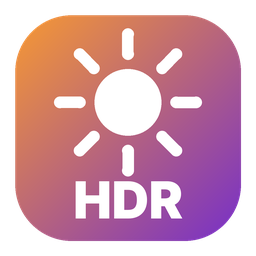
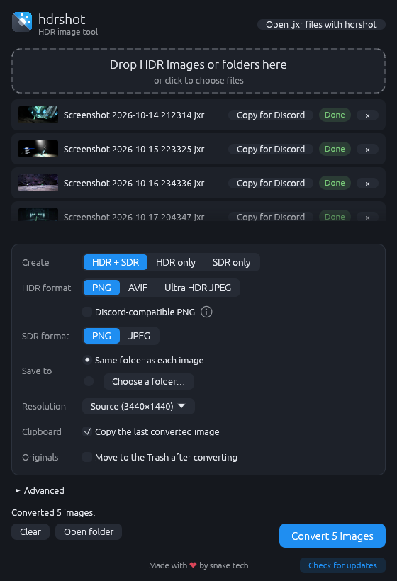

<div align="center">



# jxr2png

**Converts HDR JPEG XR (`.jxr`) screenshots to HDR and SDR PNG.**

[](https://github.com/snaketech-tu/jxr2png/releases/latest)
[](https://github.com/snaketech-tu/jxr2png/releases)
[](https://github.com/snaketech-tu/jxr2png/actions/workflows/ci.yml)
[](LICENSE)


[**Download**](https://github.com/snaketech-tu/jxr2png/releases/latest) ·
[Desktop app](#desktop-app) ·
[Command line](#command-line) ·
[How it works](#how-it-works)



</div>

Windows Game Bar and Xbox save HDR screenshots as JPEG XR, a format few
applications can open. jxr2png converts them to PNG, in HDR for screens and
apps that support it and in SDR for everything else, without changing how
the screenshot looks.

## Features

- **HDR PNG.** Rec.2020 PQ with the brightness of the original
  screenshot, shown in HDR by Windows Photos, Chrome, Edge and HDR image
  viewers.
- **SDR PNG.** Tone-mapped the way Windows shows the
  screenshot on an SDR screen, with highlights that roll off smoothly and
  colors that keep their hue.
- **Faithful by default.** Brightness, peak and white level all
  come from the screenshot itself. Tuning options are available but
  not required.
- **Drag and drop.** Drop files or whole folders, pick HDR, SDR or both,
  press Convert.
- **Copy for Discord.** One click puts the image on the clipboard in a
  form Discord shows with correct colors.
- **Double-click to convert.** Optionally opens `.jxr` files with jxr2png
  on Windows and Linux.
- **Parallel conversion.** Uses all CPU cores, written in pure Rust with no
  external libraries.

## Download

Download the archive for your system from the
[latest release](https://github.com/snaketech-tu/jxr2png/releases/latest).
Each one contains the desktop app and the `jxr2png` command-line tool.

| Platform | File | Desktop app |
| --- | --- | --- |
| Windows 10/11 (x64) | `jxr2png-vX.Y.Z-windows-x64.zip` | `jxr2png-gui.exe` |
| macOS 11+ (Apple silicon and Intel) | `jxr2png-vX.Y.Z-macos-universal.zip` | `jxr2png.app` |
| Linux (x64) | `jxr2png-vX.Y.Z-linux-x64.tar.gz` | `jxr2png-gui` |

No installer is needed: unpack it and run the app. The builds aren't signed
with a paid certificate, so the first launch needs one extra step:

- **Windows**: if SmartScreen says "Windows protected your PC", choose
  **More info**, then **Run anyway**.
- **macOS**: if the app "can't be opened", open **System Settings → Privacy
  & Security** and choose **Open Anyway** next to jxr2png (on older macOS,
  right-click the app and choose **Open**). Or remove the download
  quarantine in Terminal: `xattr -dr com.apple.quarantine jxr2png.app jxr2png`.

## Desktop app

1. Drop `.jxr` files or folders onto the window, or click the drop area to
   choose files. On Windows and Linux, files dropped onto the program's icon
   are added too.
2. Choose **HDR + SDR**, **HDR only** or **SDR only**, and whether to save
   next to each image or into one folder.
3. Press **Convert**.

<details>
<summary>More options</summary>

- **Copy for Discord.** After converting, the last PNG (the HDR one if made)
  is copied to the clipboard as a file, so pasting it into Discord, a
  browser upload or a folder gives the full file. Each converted image also
  has its own **Copy for Discord** button. The copy leaves out the `cICP`
  chunk, which makes Discord turn HDR images yellow; the saved file keeps it
  for Windows Photos and HDR viewers.
- **Resolution** scales the output down to 2160p, 1440p, 1080p or 720p,
  keeping the aspect ratio and never scaling up. It starts at Source every
  time.
- **Open .jxr files with jxr2png** (Windows and Linux) makes a double-click
  on a screenshot open it in the app. Windows asks you to confirm the choice
  in Settings.
- **Advanced** holds the tuning options from the command line. They are off
  by default and reset every time the app starts, so results always match
  the original screenshot unless you change them.
- The window is drawn on the CPU and only redraws when something changes,
  so it uses almost no CPU or GPU while idle and doesn't flicker on variable
  refresh rate monitors (G-Sync, FreeSync).

</details>

## Command line

```sh
jxr2png shot.jxr                         # writes shot_hdr.png and shot_sdr.png
jxr2png --hdr -o out/ a.jxr b.jxr        # HDR only, into out/
jxr2png --sdr --sdr-white 203 shot.jxr   # darker SDR result
```

Wildcards such as `*.jxr` work in shells that expand them (bash, zsh); in
cmd and PowerShell, list the files or use the desktop app, which also takes
folders.

Everything is automatic; these options are only for tuning:

| Option | Effect |
| --- | --- |
| `--hdr` / `--sdr` | Make only the HDR or only the SDR PNG |
| `-o, --output <DIR>` | Save into this folder instead of next to each input |
| `--hdr-peak <NITS>` | Limit the HDR PNG's brightest highlight, rolling off anything brighter |
| `--sdr-white <NITS>` | HDR brightness that becomes SDR white (default 80; lower is brighter) |
| `--sdr-peak <NITS>` | Brightness that maps to full SDR white, instead of the 99.9th percentile |
| `--max-height <PIXELS>` | Scale taller images down to this height, averaging in linear light |

Run `jxr2png --help` for the full list.

## How it works

Windows HDR screenshots store linear scRGB: BT.709 primaries, where 1.0 is
80 nits, values above 1.0 are highlights and negative values are colors
outside BT.709. Decoding uses [`jxr`](https://crates.io/crates/jxr), a pure
Rust JPEG XR decoder, so no C toolchain is needed.

| | HDR PNG | SDR PNG |
| --- | --- | --- |
| Color | Rec.2020, PQ (absolute nits) | sRGB |
| Bit depth | 16-bit, rounded to 10 bits | 8-bit |
| Metadata | `cICP`, `mDCV`, `cLLI`, ICC v4.4 with `cicp` tag and SDR fallback | sRGB |
| Brightness | Exactly the screenshot's | 80-nit SDR white, highlights rolled off |

<details>
<summary>The details</summary>

- **HDR**: converted to BT.2020 and encoded with PQ, keeping the
  screenshot's brightness exactly. Samples are rounded to 10 bits, the
  precision HDR displays use, which halves the file size. It is tagged as
  BT.2020 PQ both by a PNG `cICP` chunk, which Windows Photos and HDR image
  viewers need, and by an ICC v4.4 profile with a matching `cicp` tag, which
  Chrome and Edge also read, plus `mDCV` and `cLLI` describing the content's
  peak and average brightness so HDR viewers can fit it to the display.
  MaxCLL is the 99.99th percentile of pixel brightness, as the PNG spec
  recommends, so a few stray bright pixels don't make viewers dim the whole
  picture. SDR-only viewers that do color management (such as the Windows
  Photo Viewer) use the profile's lookup table instead, which applies the
  same SDR tone mapping as the SDR output, so they show a normal picture
  instead of a washed-out one.
- **Discord**: its image service converts PNGs with a `cICP` chunk to SDR
  with wrong colors (warm scenes turn yellow) but shows them correctly
  without it, so the app's clipboard copy leaves the chunk out (and `mDCV`,
  which the PNG spec only allows together with `cICP`).
- **SDR**: scRGB 1.0 (80 nits) becomes SDR white by default, matching how
  Windows shows these screenshots in SDR viewers. Highlights above that roll
  off smoothly up to the image's 99.9th percentile brightness. The curve is
  applied to each pixel's brightest channel and the other channels are
  scaled with it, which keeps hue and saturation.

</details>

## Building from source

With [Rust](https://rustup.rs) installed:

```sh
cargo build --release
cargo run --release -p jxr2png-gui   # desktop app
cargo run --release -p jxr2png -- --help
```

| Crate | Purpose |
| --- | --- |
| `crates/jxr2png-core` | Decoding, color conversion and PNG encoding |
| `crates/jxr2png-cli` | `jxr2png` command-line tool |
| `crates/jxr2png-gui` | Desktop app with drag-and-drop (egui) |

Captures are too large to keep in the repository. Point the sample test at
a folder of them:

```sh
JXR2PNG_SAMPLES=/path/to/jxr/folder cargo test --release -p jxr2png-core --test samples
```

Releases are built by GitHub Actions: pushing a `v*` tag builds all three
platforms and publishes the release with notes from
[CHANGELOG.md](CHANGELOG.md).

## License

[Apache-2.0](LICENSE)

Made by snake.tech. If jxr2png is useful to you, you can support it on
[Ko-fi](https://ko-fi.com/snake_tech).
