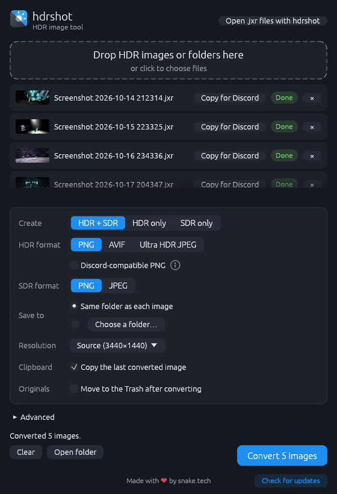
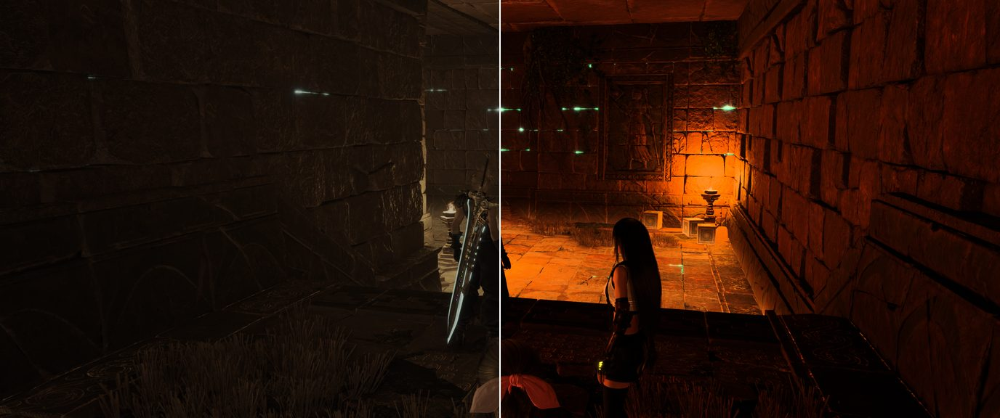
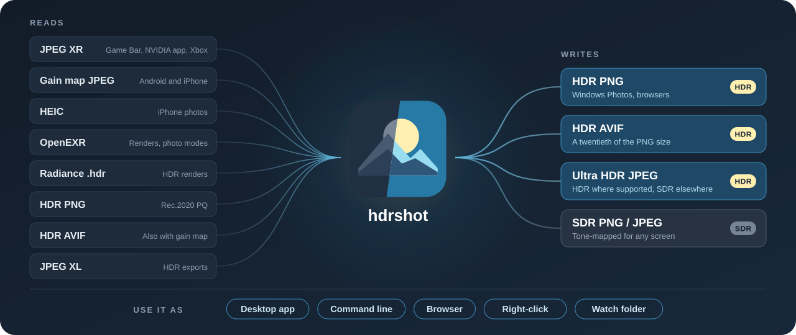

<div align="center">


# hdrshot

**Converts HDR screenshots, phone HDR photos and other HDR images to HDR
PNG, AVIF, Ultra HDR JPEG and SDR PNG.**

[](https://github.com/snaketech-tu/hdrshot/releases/latest)
[](https://github.com/snaketech-tu/hdrshot/releases)
[](https://github.com/snaketech-tu/hdrshot/actions/workflows/ci.yml)
[](https://crates.io/crates/hdrshot)
[](https://github.com/snaketech-tu/hdrshot/blob/main/LICENSE)


[**Download**](https://github.com/snaketech-tu/hdrshot/releases/latest) ·
[Try it in your browser](https://snaketech-tu.github.io/hdrshot/) ·
[Desktop app](#desktop-app) ·
[Command line](#command-line) ·
[How it works](#how-it-works)



</div>

Windows Game Bar, the NVIDIA app and Xbox save HDR screenshots as JPEG XR,
a format few applications can open. hdrshot converts them, and other HDR
images, to HDR PNG, AVIF or Ultra HDR JPEG for screens and apps that support
HDR, and to SDR PNG for everything else. The HDR result keeps the original
brightness.

<p align="center">

<br><sub>Left: an HDR screenshot in an app without HDR support. Right: converted by hdrshot.</sub>
</p>

<p align="center">

</p>

## Features

- **HDR PNG.** Rec.2020 PQ with the brightness of the original
  screenshot, shown in HDR by Windows Photos, Chrome, Edge and HDR image
  viewers.
- **HDR AVIF.** The same HDR picture as a 10-bit AVIF, about a
  twentieth of the PNG's size, shown in HDR by Chrome, Edge and Firefox.
- **Ultra HDR JPEG.** Or as a JPEG with a gain map: every app shows the
  SDR picture, and Chrome, Edge, Android and Instagram brighten it to HDR.
- **SDR PNG or JPEG.** Tone-mapped the way Windows shows the
  screenshot on an SDR screen, with highlights that roll off smoothly and
  colors that keep their hue.
- **No settings needed.** Brightness, peak and white level come from the
  screenshot itself. Tuning is optional.
- **Drag and drop.** Drop files or whole folders, pick HDR, SDR or both,
  press Convert.
- **Copy for Discord.** One click puts the image on the clipboard in a
  form Discord shows with correct colors. On Windows you can also drag it
  straight from the list into Discord.
- **Phone HDR photos.** Reads the HDR photos phones take: Ultra HDR JPEGs
  from Android phones (Pixel, Samsung, OnePlus and others), iPhone HEIC
  photos and iPhone JPEGs. They come out as bright as the phone shows them
  on an HDR screen.
- **Other HDR inputs.** Also reads OpenEXR (`.exr`), Radiance (`.hdr`),
  HDR PNG, HDR AVIF (including AVIFs with a gain map) and JPEG XL (`.jxl`)
  files, for game photo modes, renders, photo exports and re-tone-mapping.
- **Watch folder.** Converts each new screenshot saved to a
  folder, such as the Game Bar or NVIDIA app captures folder, as soon as it
  is written. On Windows it can keep doing so from the tray, starting with
  Windows if you like.
- **Double-click or right-click to convert.** Can open `.jxr` files
  with hdrshot on Windows and Linux, is listed under **Open with** for the
  other formats it reads, and on Windows adds **Convert with hdrshot** to
  their right-click menu.
- **Pure Rust.** Converts on all CPU cores, and the image code needs no C
  libraries.

## Download

The desktop app and the `hdrshot` command-line tool are separate downloads.
These links always point to the
[latest release](https://github.com/snaketech-tu/hdrshot/releases/latest).

| Platform | Desktop app | Command line |
| --- | --- | --- |
| Windows 10/11 (x64) | [`hdrshot.exe`](https://github.com/snaketech-tu/hdrshot/releases/latest/download/hdrshot.exe) | [`hdrshot-cli.exe`](https://github.com/snaketech-tu/hdrshot/releases/latest/download/hdrshot-cli.exe) |
| macOS 11+ (Apple silicon and Intel) | [`hdrshot-gui-macos.dmg`](https://github.com/snaketech-tu/hdrshot/releases/latest/download/hdrshot-gui-macos.dmg) | [`hdrshot-cli-macos.tar.gz`](https://github.com/snaketech-tu/hdrshot/releases/latest/download/hdrshot-cli-macos.tar.gz) |
| Linux (x64) | [`hdrshot-gui-linux-x64.tar.gz`](https://github.com/snaketech-tu/hdrshot/releases/latest/download/hdrshot-gui-linux-x64.tar.gz) | [`hdrshot-cli-linux-x64.tar.gz`](https://github.com/snaketech-tu/hdrshot/releases/latest/download/hdrshot-cli-linux-x64.tar.gz) |

`SHA256SUMS.txt` in each release lists the checksums of all downloads. The
app's **Update** button checks its download against this list.

No installer is needed. On Windows, run the `.exe` directly. The
command-line examples below call the tool `hdrshot`; with the Windows
download, type `hdrshot-cli` instead, or rename the file. On macOS, open
the disk image and drag hdrshot to Applications. On Linux and for the macOS
command line, unpack the archive. The builds aren't signed
with a paid certificate, so the first launch needs one extra step:

- **Windows**: if SmartScreen says "Windows protected your PC", choose
  **More info**, then **Run anyway**.
- **macOS**: if the app "can't be opened", open **System Settings → Privacy
  & Security** and choose **Open Anyway** next to hdrshot (on older macOS,
  right-click the app and choose **Open**). Or remove the download
  quarantine in Terminal:
  `xattr -dr com.apple.quarantine /Applications/hdrshot.app`,
  or `xattr -d com.apple.quarantine hdrshot` for the command-line tool.

On Linux, to list the app in your application menu and open `.jxr` files
with it, install the files from the unpacked folder (and copy `hdrshot`
from the command-line archive to `~/.local/bin` as well, if you want it):

```sh
install -Dm755 hdrshot-gui -t ~/.local/bin
install -Dm644 hdrshot.desktop -t ~/.local/share/applications
cp -r icons/hicolor ~/.local/share/icons/
```

### With Scoop

On Windows, [Scoop](https://scoop.sh) installs both tools and keeps them up
to date:

```sh
scoop bucket add snaketech https://github.com/snaketech-tu/scoop-bucket
scoop install hdrshot
```

This adds the `hdrshot` command (the command-line tool), the `hdrshot-gui`
command (the desktop app) and a Start menu shortcut. `scoop update hdrshot`
updates both; the app's **Check for updates** shows that command instead of
replacing the files itself.

### With Cargo

With [Rust](https://rustup.rs) 1.99 or newer installed, both tools can also be built from
[crates.io](https://crates.io/crates/hdrshot):

```sh
cargo install hdrshot        # command-line tool
cargo install hdrshot-gui    # desktop app
```

### In the browser

To convert a few images without installing anything, open
[snaketech-tu.github.io/hdrshot](https://snaketech-tu.github.io/hdrshot/). It
runs the same conversion as the desktop app, with the same defaults, on your
computer: images are never uploaded. It works in current versions of Chrome,
Edge, Firefox and Safari.

The desktop app is faster and does more:

| | Desktop app | Browser version |
| --- | --- | --- |
| Inputs and outputs | All formats | All formats, except AVIF input |
| Speed | All CPU cores for each image | One core per image; AVIF takes about four times as long |
| Saving | Next to the originals or into a folder, keeping the capture date | Downloads (one file or a .zip that keeps the capture date), or into a folder in Chrome and Edge |
| Copy for Discord | Clipboard, and drag out on Windows | Download, then drop the file into Discord; browsers can't copy HDR images |
| Watch folder, tray, right-click convert, Recycle Bin | Yes | No |

hdrshot was called jxr2png up to version 1.2. Settings and the `.jxr` file
association carry over, and version 1.2 updates to it from **Check for
updates**.

## Desktop app

1. Drop `.jxr` files or folders anywhere on the window, click the drop
   area or **Add files** to choose files, or paste files copied in Explorer
   or Finder with Ctrl+V.
   On Windows and Linux, files dropped onto the program's icon are added
   too. Files opened while the app is running, for example several
   screenshots picked with **Open with**, go to the window that is already
   open.
2. The row of buttons under the list shows the current settings: what to
   create (for example **HDR PNG + SDR PNG**), where to save, the largest
   size and what happens after converting. Click one to change it, for
   example to **HDR only**, **AVIF** or another folder.
3. Press **Convert**. The app shows the progress and the time left, then a
   summary of what was saved and what failed, with **Open folder** and
   **Retry failed**.

All settings are also on the **Settings** page, opened with the button at
the top right; Esc or the back button returns to the list. The window opens
where it was last closed, at the same size.

The app can also copy images for Discord, watch a folder for new
screenshots, run in the tray, convert from the right-click menu, replace
originals with the converted files and more. All options are described in
[the desktop app guide](https://github.com/snaketech-tu/hdrshot/blob/main/docs/desktop-app.md).

## Command line

```
hdrshot [OPTIONS] <INPUTS>...
hdrshot [OPTIONS] --watch <FOLDER> [INPUTS]...
```

Inputs are image files or folders. Files that already exist are skipped,
and the exit code is non-zero if any file failed.

```sh
hdrshot shot.jxr                         # writes shot_hdr.png and shot_sdr.png
hdrshot --hdr -o out/ a.jxr b.jxr        # HDR only, into out/
hdrshot *.jxr                            # wildcards work in cmd and PowerShell too
hdrshot -r Captures/                     # a folder, including its subfolders
hdrshot --sdr --sdr-white 203 shot.jxr   # darker SDR result
hdrshot --format avif shot.jxr           # HDR as AVIF instead of PNG
hdrshot --sdr --sdr-format jpeg --jpeg-quality 85 shot.jxr
hdrshot --max-height 1440 --subfolders -o out/ Captures/
hdrshot --name "{name}-{type}" shot.jxr  # writes shot-hdr.png and shot-sdr.png
hdrshot --hdr --copy-small shot.jxr      # convert, then copy for Discord
hdrshot --watch Captures/ --copy         # convert each new screenshot, copy it
hdrshot --json Captures/ > results.jsonl # one JSON line per input, for scripts
```

All options, the JSON output, exit codes and shell completions are in
[the command-line reference](https://github.com/snaketech-tu/hdrshot/blob/main/docs/cli.md).

## Sharing on Discord

Discord shows some HDR files wrong, so **Copy for Discord**, dragging an
image out of the desktop app's list and `--copy` can give Discord a
different file than the one saved. The saved files are never changed.

| Saved HDR format | What Discord does with it | What gets copied |
| --- | --- | --- |
| PNG | Its image service converts PNGs that carry a `cICP` chunk to SDR with swapped colors, so warm scenes turn yellow. Without the chunk, it shows the image in HDR. | The same PNG without the `cICP` and `mDCV` chunks. The ICC profile, which also marks the image as BT.2020 PQ, stays and is kept under 32 KB, since Discord drops larger profiles. |
| AVIF | Ignores the PQ transfer, so the image looks far too bright. | An HDR PNG made for Discord and kept in a temporary folder. The desktop app makes it while converting the last image of a batch, and for the others when Copy for Discord is clicked or the image is first dragged out. |
| Ultra HDR JPEG | Drops the gain map and shows only the SDR base image. | The same HDR PNG made for Discord. |

The saved PNG keeps `cICP` because Windows Photos and most HDR image viewers
need it to show the image in HDR; an ICC profile alone makes them show SDR.
`mDCV` is left out of the copy because the PNG specification only allows it
together with `cICP`. To save PNGs that are already in the Discord form,
turn on **Discord-compatible PNG** in the app or use `--for-discord`.

HDR in Discord works in the desktop app and in Chromium-based browsers on an
HDR display. The mobile apps do not reliably show HDR images, at least in
the inline preview. Discord's upload limit for free accounts is 10 MB, so the
app offers a smaller copy when the PNG is larger.

## How it works

Windows HDR screenshots store linear scRGB: BT.709 primaries, where 1.0 is
80 nits, values above 1.0 are highlights and negative values are colors
outside BT.709. Decoding uses [`jxr`](https://crates.io/crates/jxr), a pure
Rust JPEG XR decoder, so no C toolchain is needed.

| | HDR PNG | SDR PNG |
| --- | --- | --- |
| Color | Rec.2020, PQ (absolute nits) | sRGB |
| Bit depth | 16-bit, rounded to 10 bits | 8-bit |
| Metadata | `cICP`, `mDCV`, `cLLI`, ICC v4.4 with `cicp` tag and SDR fallback | sRGB |
| Brightness | Exactly the screenshot's | 80-nit SDR white, highlights rolled off |

The details, including AVIF, Ultra HDR JPEG and every input format, are in
[How hdrshot works](https://github.com/snaketech-tu/hdrshot/blob/main/docs/how-it-works.md).

## Building from source

See [CONTRIBUTING.md](https://github.com/snaketech-tu/hdrshot/blob/main/CONTRIBUTING.md).

## Feedback

To report a problem or ask for a feature,
[open an issue](https://github.com/snaketech-tu/hdrshot/issues/new/choose).
Questions and ideas are welcome in
[Discussions](https://github.com/snaketech-tu/hdrshot/discussions). To report a
security problem privately, see
[SECURITY.md](https://github.com/snaketech-tu/hdrshot/blob/main/SECURITY.md).

## Credits

hdrshot uses these open source projects, among others. Thanks to their
authors and contributors.

**Image formats**

- [jxr](https://github.com/frames-sg/jxr): JPEG XR decoding
- [exrs](https://github.com/johannesvollmer/exrs): OpenEXR decoding
- [jxl-oxide](https://github.com/tirr-c/jxl-oxide): JPEG XL decoding
- [heic-decoder](https://github.com/Multipad-cyber/heic-decoder-rust): HEIC decoding
- [rav1d](https://github.com/memorysafety/rav1d), the Rust port of
  [dav1d](https://code.videolan.org/videolan/dav1d): AV1 decoding for AVIF input
- [rav1e](https://github.com/xiph/rav1e): AV1 encoding for AVIF output
- [avif-serialize](https://github.com/kornelski/avif-serialize): AVIF container writing
- [png](https://github.com/image-rs/image-png) and
  [image](https://github.com/image-rs/image): PNG and Radiance HDR files
- [zune-jpeg](https://github.com/etemesi254/zune-image) and
  [jpeg-encoder](https://github.com/vstroebel/jpeg-encoder): JPEG decoding and encoding
- [moxcms](https://github.com/awxkee/moxcms): color management for JPEG XL

**Desktop app**

- [egui](https://github.com/emilk/egui): user interface
- [egui_software_backend](https://github.com/DGriffin91/egui_software_backend)
  by DGriffin91: the CPU renderer, included in this repository in adapted form
- [winit](https://github.com/rust-windowing/winit) and
  [softbuffer](https://github.com/rust-windowing/softbuffer): window and drawing
- [rfd](https://github.com/PolyMeilex/rfd): file dialogs
- [arboard](https://github.com/1Password/arboard): clipboard
- [notify](https://github.com/notify-rs/notify): watch folder
- [trash](https://github.com/ArturKovacs/trash): Recycle Bin support
- [ureq](https://github.com/algesten/ureq) and
  [rustls](https://github.com/rustls/rustls): update check
- [interprocess](https://github.com/kotauskas/interprocess): single instance
- [serde](https://github.com/serde-rs/serde) and
  [ron](https://github.com/ron-rs/ron): settings
- The [Inter](https://rsms.me/inter/) typeface by Rasmus Andersson, under the
  [SIL Open Font License 1.1](https://github.com/snaketech-tu/hdrshot/blob/main/crates/hdrshot-gui/assets/fonts/Inter-LICENSE.txt)

**Command line and browser version**

- [clap](https://github.com/clap-rs/clap): command-line options
- [rayon](https://github.com/rayon-rs/rayon): parallel conversion
- [wasm-bindgen](https://github.com/wasm-bindgen/wasm-bindgen) and
  [Binaryen](https://github.com/WebAssembly/binaryen): the WebAssembly build

The full list of dependencies is in
[Cargo.lock](https://github.com/snaketech-tu/hdrshot/blob/main/Cargo.lock).

## License

[Apache-2.0](https://github.com/snaketech-tu/hdrshot/blob/main/LICENSE)

Made by snake.tech. If hdrshot is useful to you, you can support it on
[Ko-fi](https://ko-fi.com/snake_tech).
